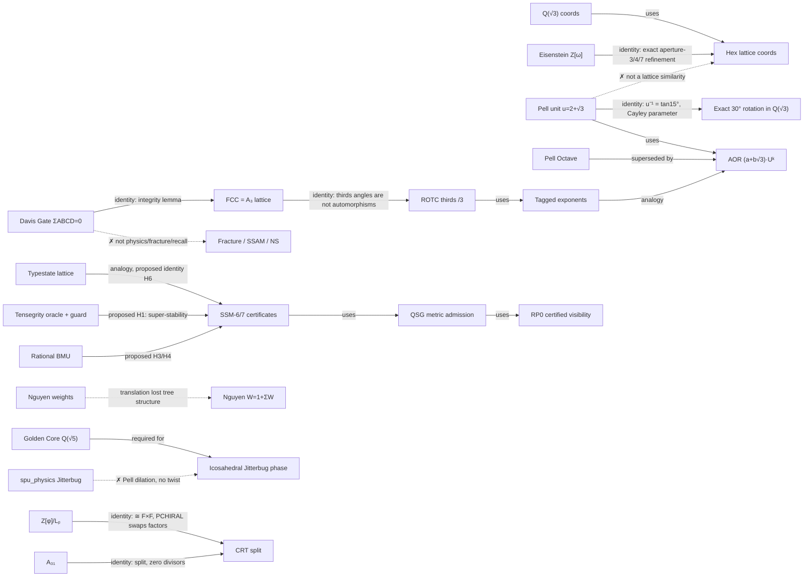

# Knowledge archaeology review — `knowledge/` (2026-10-20)

Read-only intellectual review of all 25 documents in [`knowledge/`](../knowledge/),
cross-checked against the code they name and the current research portfolio
(SSM-0…7, AOR-S1, QSG-0…2/RP0, Golden Core, tensegrity, SOM). No knowledge file,
production code, RTL or evidence was modified. No build, hardware or
qualification job was run. Three small read-only computations were run to
verify specific claims; they are listed in §7.

**Status vocabulary used below**

| Label | Meaning |
|---|---|
| **identity** | a mathematical fact, provable independent of the SPU |
| **silicon** | has an entry in [`docs/hardware_evidence.md`](hardware_evidence.md) (cited where used) |
| **TB / oracle** | testbench- or software-oracle-verified only |
| **helper** | implemented in a software header/library with unit tests, not used by RTL or a loader |
| **proposal** | written down, not implemented |
| **falsified** | a specific hypothesis tested and refuted (kept) |
| **claim-error** | a statement in the document that is mathematically wrong or contradicted by the code it names |

"Related" in this document never means "equivalent". Where two structures share
a symbol or a field, §3 says which relation actually holds.

---

## 1. Catalogue

### 1.1 Foundations and vocabulary

| Document | Purpose | What it actually contains | Current standing |
|---|---|---|---|
| [MATHEMATICAL_FOUNDATIONS.md](../knowledge/MATHEMATICAL_FOUNDATIONS.md) | Lineage Fuller → Wildberger → Davis → SPU; why Q(√3) | Q(√3) closure, spread, Davis Law framing, Quadray conventions, A₃₁ algebra (§8) | §3 "Q(√3) is the *necessary* field" and §5 physics claims (Navier–Stokes, gimbal lock, Gibbs) are **claim-errors** (§6.1). A₃₁ §8 residues verified (§7). |
| [SPU_LEXICON.md](../knowledge/SPU_LEXICON.md) | Normative vocabulary | Quadray, SQR, IVM, Jitterbug, RationalSurd, A₃₁, Lucas, Davis Gate + sum-invariance lemma, /3 truncation finding, τ/K, Piranha, jets, cluster terms | Mostly careful and current. The Davis Gate lemma and the /3 analysis are the strongest content in `knowledge/`. Jitterbug entry and "60° inter-axis angles" are **claim-errors** (§6.2, §6.3). |
| [SPU13_ARCHITECTURE.md](../knowledge/SPU13_ARCHITECTURE.md) | Map of the cortex | Representation table, dispatch, Davis Gate, register namespaces, sidecars, module map | Recently re-audited and honest. Use as the navigation map. |
| [SPU4_ARCHITECTURE.md](../knowledge/SPU4_ARCHITECTURE.md) | Sentinel edge core | Dual role, cluster frame format, evidence table | Current, except it lists "Precession — RTL" while the lexicon calls it orphaned. |
| [HARDWARE_MANIFEST_SPU13.md](../knowledge/HARDWARE_MANIFEST_SPU13.md) | Board/tier manifest | Self-declared **STALE** (2026-07-16) | Historical. Its "128 KB Fractal Memory" is one of the claimed sources for fractal addressing (§2.2). |
| [CLOCK_ARCHITECTURE.md](../knowledge/CLOCK_ARCHITECTURE.md) | Two clock domains, Fibonacci dispatch | PLL derivation, 34-cycle Sierpinski frame, target-vs-realised 61.44 kHz | Mechanism real; "EM profile follows field geometry", the MTBF line and "76/34 ≈ √5" are unmeasured or numerology (the lexicon already bars the last). Contains an unedited "Wait —" draft passage (§2.4). |
| [INTERCONNECT_ARCHITECTURE.md](../knowledge/INTERCONNECT_ARCHITECTURE.md) | Tiers, determinism boundary | Command/coherence planes, homogeneity contract, radio/IP options | Sound. The **determinism boundary** principle is a durable architectural idea. |
| [contract_template.md](../knowledge/contract_template.md) | Contract skeleton | Template | Governance, not research. |

### 1.2 ISA, language and arithmetic subsystems

| Document | Purpose | What it actually contains | Current standing |
|---|---|---|---|
| [isa_reference.md](../knowledge/isa_reference.md) | Canonical encoding | Opcode tables, Surd CPU extension, REGEN, FLAGS, tagged-ROTC golden vectors | Canonical. Its 0x11 QROT definition ("× (2+√3)ⁿ") contradicts ISA_QUICKSTART and Lithic-L (permutation). The SOM row still says "parallel 7-node array" (archived design). |
| [ISA_QUICKSTART.md](../knowledge/ISA_QUICKSTART.md) | Worked introduction | Register model, examples, identities | Contains several **claim-errors** (§6.3–6.5): QROT/QNORM/SNAP semantics differ from the reference; Quadray "non-negative"; "N = −1 half-step"; the 60° spread example fails in the VM. |
| [rotc_tables.md](../knowledge/rotc_tables.md) | ROTC 0–35 catalogue | F/G/H, periods, inverses, tranches | Normative and verified by trace tests. §2.3 below gives the lattice-theoretic reason for the /3 problem. |
| [PELL_OCTAVE.md](../knowledge/PELL_OCTAVE.md) | Overflow-free Pell powers | `(octave, step)` exponent bookkeeping, u⁸ = 18817+10864√3 | Correct as bookkeeping and **superseded** by AOR-1's `(a+b√3)·Uᵏ` representation. "Fractal" framing and §5 range numbers are wrong (§6.4). |
| [LUCAS_PHINARY_MAC.md](../knowledge/LUCAS_PHINARY_MAC.md) | Z[φ]/Lₚ coprocessor | PSCALE/PCHIRAL/PMUL/PINV/PHSLK, resource tables | Silicon on Artix-7 and Tang `FAST_ONLY` per [`hardware_evidence.md`](hardware_evidence.md) §3.2e. The ring-theory rationale has errors (§6.6). |
| [LITHIC_L_LANGUAGE_SPEC.md](../knowledge/LITHIC_L_LANGUAGE_SPEC.md) | Field-native language | Type system, EBNF, MUX transform, weighted types, Chord encoding | Parser never built. The control-flow opcode numbers contradict the frozen canonical boundary. Ordering semantics are wrong for surds (§6.5). |
| [LITHIC_L_DEEP_DIVE.md](../knowledge/LITHIC_L_DEEP_DIVE.md) | "Gestalt programming" | 16-bit chord word, ROTR/TUCK/SIP/SYNC | Vision text. It conflicts with the 64-bit canonical ISA and has no implementation. |
| [THEOREM_LICENSED_TYPESTATE.md](../knowledge/THEOREM_LICENSED_TYPESTATE.md) | Verification method | Three-layer discipline, bug ledger, φ-plane lattice, SVA comparison | **Demonstrated method** (published paper is the authoritative source). Has internal metric conflicts (121/150 vs 105/155 lines, 52/52 vs 70/53 cells, 38 vs 41 checks); already partly flagged in the doc itself. |

### 1.3 Weighting, memory, OS and multi-agent notes

| Document | Purpose | What it actually contains | Current standing |
|---|---|---|---|
| [NGUYEN_WEIGHT_PARTITIONING.md](../knowledge/NGUYEN_WEIGHT_PARTITIONING.md) | Quadrance weights → memory tiers, wedges, LOD, zoom | Four mappings, RAM layering, loader primitive | **helper**: `axis_weight`, `laminar_weight`, `wedge_fraction`, `bram_tier`, `pell_zoom_scale`, `manifold_pell_zoom` exist in [`spu_ivm.h`](../software/common/include/spu_ivm.h) and are unit-tested (`spu_ivm_test.cpp`). No RTL, loader or placement uses them. `manifold_spread_sum()` does **not** exist. Several mapping claims are **claim-errors** (§6.7). |
| [RATIONAL_SOM_NGUYEN_CLUSTER_NOTES.md](../knowledge/RATIONAL_SOM_NGUYEN_CLUSTER_NOTES.md) | Recovered SOM/cluster direction | Weighted-quadrance BMU, dyadic update, hex/Quadray topology, staging, rough-set reading of "Nguyen" | Stage 1–2 realised: BMU oracle + RTL (cross-vendor silicon, SOM1 entries in [`hardware_evidence.md`](hardware_evidence.md)). The cluster/rough-set stage is **proposal**. The SOM research tranche was closed 2026-09-11 with "application advantage not demonstrated". |
| [STSC_SSAM_MULTI_AGENT_NOTES.md](../knowledge/STSC_SSAM_MULTI_AGENT_NOTES.md) | Simulator, associative memory, resonance | Recovered traces; referenced `.sas` files do not exist | **proposal**, with a mechanism gap: Henosis has no attractors, so it cannot recall a pattern (§2.5). |
| [LAMINAR_UI_MANAGER.md](../knowledge/LAMINAR_UI_MANAGER.md) | Weight-driven desktop | Windows as weight wedges, Jitterbug work/leisure | Speculative. Inherits the Nguyen and Jitterbug errors. |
| [observer_stack_philosophy.md](../knowledge/observer_stack_philosophy.md) | Hardware observes, software decides | Four-layer observer, model-out-of-loop | Sound principle and consistent with the SSM rule that a proposer never certifies. |

### 1.4 Graphics, spatial and physics

| Document | Purpose | What it actually contains | Current standing |
|---|---|---|---|
| [ARLINGHAUS_SPATIAL_SYNTHESIS.md](../knowledge/ARLINGHAUS_SPATIAL_SYNTHESIS.md) | Hex hierarchies, buffers, constellation | Micro/meso/macro, fracture model, deployment tiers | Deployment section (§7) is honest and current. Mathematical sections contain **claim-errors**: hex nesting, Pell "closes after 8 steps", "hexagonal close-packed" (§6.8). [`spu_hex_hierarchy.h`](../software/common/include/spu_hex_hierarchy.h) is a 7-child **helper** with tests. |
| [RATIONAL_SHADER.md](../knowledge/RATIONAL_SHADER.md) | Rational raster/shading | Self-declared **STALE**; modules never built | Superseded by the current `hardware/rtl/gpu/` raster/depth path and the T1d/T1G evidence. Shading formula and projection are wrong (§6.9). |
| [RATIONAL_CURVES_SPEC.md](../knowledge/RATIONAL_CURVES_SPEC.md) | Kinematics/trajectory primitives | Pell "circle", circulants + inverse rule, FK, interpolation, RPLU correction, triple-quadrance | The circulant inverse/closure discipline is realised in `rational_robotics.py` and its tests. The Pell-arc, Pell-Jacobian and `davis_snap` definitions are **claim-errors** (§6.2, §6.10). |
| [SYNERGETICS_BEYOND_GEOMETRY.md](../knowledge/SYNERGETICS_BEYOND_GEOMETRY.md) | Real vs named-only synergetics | Audit table | Valuable self-audit, but now stale in two directions. Real tensegrity mechanics exists since July (`spu13_tensegrity_guard.v`, silicon §3.2l), so "no strut/cable distinction anywhere in RTL" is out of date. Its "Jitterbug: real and tested" verdict does not survive reading the code (§6.2). |

---

## 2. Idea ledger by theme

Each entry: **mechanism**, **record** (proposed / implemented / tested / falsified),
**superseded by**, **connections**, **missing assumptions**, **smallest experiment**
(only where reopening is warranted).

### 2.1 Mathematical foundations

**F1 — Q(√3) as the IVM field.**
*Mechanism:* the 60° hexagonal cross-sections need cos 60° and sin 60° = √3/2.
*Record:* the field arithmetic is implemented everywhere and is silicon (core arithmetic probes).
*Missing assumption:* the IVM (FCC = A₃ root lattice) is an **integer** lattice in Cartesian
coordinates (`Z³` with even coordinate sum). Its quadrances are integers and its
Cartesian coordinates need no √3. √3 enters through *planar hexagonal coordinates*
and *30°/60° rotations*, not through the lattice itself. "Necessary field" is too strong. The
defensible claim is "Q(√3) is the natural coordinate field for hexagonal sections
and for the exact 12-fold planar rotation group" (see F4).
*Connections:* Golden Core shows Q(√5) is required for icosahedral geometry, so the
SPU is already a multi-field machine. QSG-1 separates metric validity from rational representability.

**F2 — Quadray zero-sum representation and the Davis Gate.**
*Mechanism:* registers hold displacements on the hyperplane ΣABCD = 0, and every hot-path op
preserves that hyperplane (the lexicon's sum-invariance lemma).
*Record:* lemma proven. Gate silicon as the Davis/VE invariant layer. The mod-2¹⁶ aliasing is
documented. The quadrance/severity formula 4Σcᵢ² = Q + S² is reconciled across the three layers.
*Missing assumption, stated by the lexicon itself and contradicted elsewhere:* this is an
**integrity check on machine state**, not a physical stability criterion. Documents that read
ΣABCD ≠ 0 as fracture, turbulence, Navier–Stokes irregularity, window "fighting" or
associative recall contradict the lemma (§6.1, §6.8, §2.5).

**F3 — Quadray metric and spread.**
*Mechanism:* quadrance Σ_{i<j}(cᵢ−cⱼ)², spread 1 − (u·v)²/(Q(u)Q(v)).
*Record:* the VM implements both, with **inconsistent bilinear forms**. `quadrance()` uses the
Quadray metric (for zero-sum vectors, `4·Σcᵢ²`). `dot()` uses the naive `Σuᵢvᵢ`. The resulting
spreads are wrong: two IVM edge directions at 60° return **63/64** (true 3/4), and two Quadray
basis directions return **1** (true 8/9). See §7 (C1).
*Missing assumption:* the Quadray basis vectors meet at the tetrahedral angle arccos(−1/3)
(spread 8/9), not at 60°. The 60° angles are between *edge* vectors eᵢ − eⱼ.
*Smallest experiment:* not research. A one-line correction (`dot = 4Σuᵢvᵢ − ΣuΣv`) plus the
two vectors above as regression fixtures. It touches the stable simulator, so it needs an
owner decision on profile versioning (AGENTS.md §4.4).

**F4 — The Pell unit u = 2+√3 ("Pell rotor").**
*Mechanism:* the powers uⁿ = aₙ + bₙ√3 satisfy aₙ² − 3bₙ² = 1.
*Record:* VM `ROT`, `spu_rotor_vault.v`, `pell_zoom`, the Jitterbug and "circular arcs" all
use it. PELL_OCTAVE's bookkeeping is correct, and AOR-1 Phase A (closed PASS) generalises it.
*Missing assumption (the most consequential across `knowledge/`):* multiplying a value by u
is a **real dilation by ≈3.732**. The field norm N(x) = x·x̄ is preserved, which makes u a
*hyperbolic* rotation of the coefficient plane (a,b) under the form a² − 3b². It is not a
Euclidean rotation, it does not have unit Euclidean quadrance, and it has infinite order.
"Closes after 8 steps", "12 steps ≈ one rotation" and "points on the unit circle" are all false.
*What survives, and is worth reopening:* u⁻¹ = 2 − √3 = **tan 15°**. By the Weierstrass/Cayley
parametrisation, t = 2 − √3 gives cos θ = (1−t²)/(1+t²) = √3/2 and sin θ = 1/2, i.e. the
**exact 30° rotation** [[√3/2, −1/2], [1/2, √3/2]] with entries in Q(√3) and period 12.
So the historical intuition "Pell ↔ 12-fold rotation" has a real algebraic kernel. u is the
*half-angle parameter* of the generator of the exact Q(√3) rotation group. It is not a rotor
applied by multiplication. Composition happens by tangent addition, not by uᵏ.
*Connections:* AOR (compact exponent state), HPG-1 (scale labels), ROTC, QSG-2 (PH curves use
the same Cayley/half-angle machinery).

**F5 — ROTC thirds angles and the /3 problem.**
*Mechanism:* circulants (⅔, ⅔, −⅓) and permutations on (B,C,D) with A invariant.
*Record:* catalogue 0–35 trace-verified. Silent `div3` truncation found 2026-07-08; tagged-exponent
core TB-verified, silicon pending.
*Lattice-theoretic explanation (not stated anywhere in `knowledge/`):* the eigenvalues of
circulant (⅔, ⅔, −⅓) are 1 and e^{±iπ/3}, so angle 1 is a **60° rotation about a tetrahedral
3-fold axis**, and angle 3 is 180° about the same axis. Neither is an automorphism of the
FCC/A₃ lattice: the point group O_h has only C₃ and S₆ about ⟨111⟩, no C₆ and no C₂. The image
of the integer zero-sum lattice therefore leaves the lattice and lands in ⅓·A₃. Exactness is
recovered only on the sublattice the lexicon found empirically (invariant axis ≡ 0 mod 3).
Angles 2, 5 and 15–35 are genuine lattice symmetries, which is why they need no division.
The tagged-exponent design is the correct response: it carries 3-adic denominators explicitly.
*Related finding:* QROT as "(a,b,c,d) → (b,c,d,a)" is a **4-cycle**, an odd permutation of the
tetrahedral vertices. On the zero-sum hyperplane it has determinant −1, so it is a
*rotoreflection*, not a rotation. Lithic-L's "6 qrots return to start" is also false: the period is 4.
*Smallest experiment:* §4 H5.

**F6 — Lucas phinary ring Z[φ]/Lₚ.**
*Record:* silicon on Artix-7 and Tang `FAST_ONLY` per [`hardware_evidence.md`](hardware_evidence.md) §3.2e. The 1M-step zero-drift oracle passes.
*Missing assumptions:* (a) for odd p, Lₚ ≡ ±1 (mod 5) (verified for 11, 29, 199, 521; §7 C3).
Such primes split in Z[φ], so **Z[φ]/Lₚ ≅ F_{Lₚ} × F_{Lₚ} always has zero divisors**. The
document's reason for isolating the rings ("merging would introduce zero divisors") applies
equally to its own ring. PHSLK's `zero_divisor` output shows the implementation already knows this.
(b) "φᵖ ≡ ±1 mod Lₚ" is not what the definition gives: for odd p, Lₚ = φᵖ − φ⁻ᵖ ⇒ **φ^{2p} ≡ 1**.
(c) PCHIRAL is the Galois automorphism √5 ↦ −√5, which *swaps the two CRT factors*. It is not
a spatial mirror. The name is fine if the meaning is stated.
*Smallest experiment:* §4 H10.

**F7 — A₃₁ split biquadratic algebra.** Residue facts verified (§7 C2). Consistent across
documents and trapped by FLAGS.V. Settled.

**F8 — Rational trigonometry.** Quadrance/spread/triple-quad identities are correct as
**identities**. Two misuses recur. Spread is not additive (summing spreads is not the spread of
a sector; see F10/§6.7). Quadrance is not a metric: it violates the triangle inequality (for
collinear points 0,1,2: Q = 4 > 1 + 1). Any pruning or partition argument "by quadrance" needs
the triple-quad relation or exact surd-sum predicates instead (§4 H3).

**F9 — Golden Core (docs/GOLDEN_CORE_*).** This is not a `knowledge/` document, but it supersedes
the knowledge claims about icosahedral phases. Q(√5) is **required** for the icosahedron
(GC-3). Exact rank-60 reversible operators and mirror covariance pass (GC-6). It is the correct
field for any Jitterbug icosahedral state (F-P2 below).

### 2.2 Alternative computing architecture

**A1 — Lithic-L / Laminar Lang.** *Proposed:* a field-native, branch-free, unrolled language with
weighted types. *Implemented:* the assembler and VM exist. Parser, type checker and weighted
types were never built. *Missing assumptions:* comparison "on the P component" is not an
ordering of Q(√3) (it says 1 > √3). Exact surd ordering exists (`rs_lt` and similar), and the
spec must use it. `COND` jumps on the sign of Q, which is wrong for the same reason. SNAP is
defined as "every register has Pell norm 1", which conflates the scalar unit group with the
Quadray zero-sum invariant. Under that definition any ordinary value such as 5 fails SNAP.
*Superseded by:* the canonical ISA reconciliation (control boundary frozen 2026-10-09) and,
conceptually, by **SSM-7**. SSM-7's bounded command stream over immutable certified states
is the first implemented thing that matches the "tell the lattice what to become" ambition
without the mysticism. *Smallest experiment:* none now. If a language is revived, its first
target should be SSM-7 commands, not .sas.

**A2 — Nguyen weighting.** *Implemented:* C++ helpers only (§1.3). *Record of the translation:*
Nguyen's W(v) = 1 + ΣW(children) is a **subtree-size count over a hierarchy**. The SPU translation
replaced it with Σ quadrance over 13 flat axes. That discards the tree, and therefore the
property the original algorithm exploits. Weight then measures geometric magnitude. Nothing
connects magnitude to access frequency or importance.
*Attribution conflict:* NGUYEN_WEIGHT and LAMINAR_UI cite Q. V. Nguyen
(space-optimised tree/treemap visualisation). The SOM notes say "Nguyen" means either
Nguyen–Widrow initialisation or Hung Son Nguyen's tolerance rough sets. These are three
unrelated sources under one name. Keep the attribution provisional, as the coordinator recommends.
*Smallest experiment:* NGW-1 as briefed, plus one control the brief omits: the original
**structural** weight (subtree count over an explicit hierarchy) against the quadrance weight
and against access frequency. That is the only comparison that tests the translation itself.

**A3 — Fractal (bit-interleaved) addressing.** The NGUYEN document calls it "already correct
and should remain". *Finding:* no implementation exists in the active tree. The only mentions are
the stale manifest, `hardware/docs/PLATFORM_SPEC.md` (address-map prose) and the Lithic-L
documents. It is a **proposal**, and an unnamed one, because "7-pixel sip" suggests aperture-7
hex Morton-like ordering (generalised balanced ternary), not binary bit interleaving. Keep it
distinct from weighting, as the brief says. If HPG-1 runs, a GBT-style aperture-7 address is
the natural concrete version to test.

**A4 — Davis Ratio τ/K, Henosis, ANNE decay.** Implemented with exact cross-multiplied
comparisons. K is fixed at unity, and no test exercises non-unity K (the lexicon says so).
τ's "relaxation" is an integer `>>1` decay. It is **not** a relaxation dynamics on geometry,
which matters for STSC/SSAM (§2.5).

**A5 — Fibonacci-gated dispatch.** Implemented. Determinism is the defensible property. EM,
"geometric switching profile" and √5 numerology are unmeasured. Not a research priority.
`spu_physics.h`'s `is_phi8_gate(cycle % 8)` uses period-8/13/21 gates, which differ from the
34-frame positions 8/13/21. That is two meanings under one name.

**A6 — Determinism boundary, coherence vs command planes, constellation.** Sound principle.
RTL+TB for bridge, node link, whisper v1 and aggregator. No board-to-board system. Future,
correctly bounded.

**A7 — Observer stack.** "Hardware observes, software decides" is the same separation the
tensegrity and SOM-S2 plans need: the classifier proposes, the constraint checker certifies.
Already the house rule. No experiment needed.

**A8 — Typestate.** *Demonstrated.* The φ-plane join-semilattice is a real verification
technique with a published paper. *Connection not yet drawn:* SSM-6's certificate-carry rules
(valid / invalidated / recomputed, with dependency footprints) are a typestate over
*certificates*. The lattice-join view would give SSM a hardware-realisable guard form (§4 H6).

### 2.3 Graphics and spatial computing

**G1 — Arlinghaus hex hierarchies.** *Claim:* "a micro-cell hex breaks cleanly into sub-hexes".
*Fact:* regular hexagons do not tile a regular hexagon. Aperture-3/4/7 hierarchies define
ownership across overlapping boundaries, which the coordinator also noted.
*The exact algebra that is missing from every SPU document:* the hexagonal lattice is the
Eisenstein integers Z[ω] ⊂ Q(√−3). Its similarities are multiplications by nonzero z ∈ Z[ω],
with index N(z) = a² − ab + b². **Aperture 3 = multiplication by (1−ω)** (scale √3, rotation 30°).
**Aperture 4 = multiplication by 2. Aperture 7 = multiplication by an element of norm 7**, e.g.
(3+ω), with rotation ≈ 19.1°. These are exact, lattice-preserving refinement operators, and
their Cartesian coordinates live in Q(√3). So Q(√3) is the right *coordinate* field and Z[ω]
is the right *refinement* ring.
*Consequence for HPG-1 (prediction, to be confirmed by enumeration):* the real Pell scale
2+√3 is not the absolute value of any Eisenstein integer, since its square 7+4√3 is irrational.
**Pell scaling therefore cannot map the hex lattice onto itself or onto any sublattice.**
Pell levels can still label *object* scales (AOR-style). They cannot be grid refinements.

**G2 — Pell zoom / LOD.** `manifold_pell_zoom` multiplies every axis by uⁿ, which is a
dilation, so quadrance scales by u²ⁿ. That is an exact scale ladder with ratio ≈3.73. It is
not "no distortion" in any sense beyond exactness. Compare with aperture-3 (ratio √3) and
aperture-4 (ratio 2) ladders in HPG-1.

**G3 — Rational shader.** Stale and superseded by the current GPU path. Two mathematical
errors are worth recording so they do not return. **Shading by spread (sin²θ) is inverted:**
Lambert-like shading needs the cross, 1 − s = cos²θ. Spread shading is brightest at grazing
light. The projection `x = a−c, y = b−d` is an exact parallel projection along a 2-fold axis
onto a non-orthonormal frame. It is not "the canonical IVM→Cartesian conversion".

**G4 — Vertexless rendering / certified observation.** Current home: QSG-RP0 (proposal,
pilot prepared, not run). Strongest bridge from SSM to the GPU, because a certified
EXACT/UNRESOLVED cell is exactly what SSM-6/7 observations produce.

**G5 — "Cartesian projection distortion" (ARLINGHAUS §5, MATH §1).** A change of basis is
exact. The defensible advantage is preserving symmetries and invariants natively and
choosing *where* approximation occurs, as the coordinator stated. This is a **claim-error**
as written.

### 2.4 Physics and robotics

**P1 — Tensegrity.** *Record:* the exact oracle, the six-guard admission guard (silicon §3.2l)
and four-act transactional behaviour are real. Single-strut rotation was **falsified**
(2026-09-04: recovery-by-not-moving). Paired-strut Option A was **falsified** (commit `8f3922e`:
1/24 balanced = identity). *Unexplored mechanism:* Connelly super-stability. If the stress
matrix is PSD with nullity d+1 and member directions avoid a conic at infinity, then every
affine image of the framework is in equilibrium with the **same** stress. The canonical
struts are axis-aligned, so the affine maps preserving strut lengths are exactly the metrics
M = AᵀA with unit diagonal. That is a 3-parameter family of *non-congruent* balanced shapes.
Their quadrances are rational, but their coordinates generally need square roots. The
integer-coordinate ABI reaches only signed permutations, i.e. congruent copies. If this
holds, it reconciles both falsifications as limits of the **representation**. That is the
09-06 handover hypothesis, now with a specific mechanism. *Design:*
[`research/phy_r1/DESIGN_PAUSED.md`](../research/phy_r1/DESIGN_PAUSED.md) (§4 H1).

**P2 — Jitterbug.** *Claimed (lexicon, SYNERGETICS):* 8-phase Pell interpolation, "phase 0 =
VE (equal scale)", "phase 2 = icosahedron (equal Pell weight both rings)", "most mature"
synergetics content. *Code* (`spu_physics.h` `jitterbug_apply`): the even ring is scaled by
u^phase and the odd ring by u^(7−phase). There is no rotation or twist and no φ. At phase 0
the rings differ by u⁷ ≈ 10⁴, and they are never equal at any integer phase. "8-step closure"
is a mod-8 counter wrapping, so the closure test is close to vacuous. A regular icosahedron
needs Q(√5) (GC-3), so no Q(√3) state can be one. **claim-error, and the status should be
downgraded** from "real and tested" to "a Pell-dilation phase counter with Jitterbug names".
`OP_JITTER` is a genuine permutation opcode, but its (a,b,c,d)→(c,a,b,d) is a 3-cycle of
tetrahedral vertices, i.e. a **120°** rotation about the D axis (the lexicon calls it 60°).
No fixed permutation is the Jitterbug motion.
*Worth reopening:* §4 H7.

**P3 — Rational curves/kinematics.** The circulant closure discipline is real
(`test_rational_robotics.py`). The inverse-coefficient formulas are the circulant adjugate,
which is correct when det = 1. *But* det = 1 alone does not make a circulant a rotation.
Orthogonality also needs F² + G² + H² = 1 and FG + GH + HF = 0. The catalogue entries satisfy
both, so the spec should state the sufficient condition. The Pell arc, Pell-step Jacobian,
Janus-polarity-by-Pell-step and `davis_snap: Σ quadrance == 0` are **claim-errors**. The last
means "every axis is the zero vector", not ΣABCD = 0.

**P4 — Hierarchical destructible geometry.** It conflates the integrity invariant with fracture
mechanics. A fracture model needs connectivity, a force or energy law, thresholds and
conservation, as the coordinator noted. Defer it. The SSM invalidation machinery is the part
that would be reused.

**P5 — IVM Laplacian.** A genuine exact operator (12-neighbour Laplacian on the cuboctahedral
stencil). It is renamed honestly and has no meaningful testbench. It is the most natural
seed for *exact discrete physics* that is not tensegrity (§4 H8).

**P6 — Precession, proprioception, soul metabolism, active inference.** Orphaned, archived or
unverified. No reopening is warranted until a contract defines the mechanism.

### 2.5 Learning and classification

**L1 — Rational quadrance SOM/BMU.** Demonstrated: cross-vendor silicon (SOM1), exact
tie-breaking and confidence gap. The research tranche closed with application advantage not
demonstrated. The INA226 result is *ambiguous* (session drift), not negative.

**L2 — Nguyen cluster / tolerance rough sets.** **proposal**, never tried. It is the most
mathematically distinct unexplored learning idea in `knowledge/`. Exact tolerance classes give
**three-valued** membership (certainly in / possibly in / unresolved), which is the classifier
analogue of SSM's EXACT/UNRESOLVED and of the BMU "ambiguous" flag (§4 H4).

**L3 — SSAM (associative memory).** *Mechanism gap:* every zero-sum vector is "laminar", so the
Davis predicate has no stored-pattern attractors. Henosis projects back onto the hyperplane
and does not move toward an imprint. The recorded "relaxation" traces are the `>>1` τ decay.
As written it cannot recall anything. *What would work:* recall = exact nearest stored
prototype, which is what the existing BMU already computes, with the confidence gap as the
certificate of a unique basin. SSAM is therefore L1 + L2 under another name, not a new
mechanism.

**L4 — Thimble-Padé / Lefschetz.** RPLU2 Padé is silicon (reduced clock) per
[`hardware_evidence.md`](hardware_evidence.md). The physics reading is unsupported: "no sign
problem, no truncation drift" contradicts the fact that a [4/4] Padé is an *approximant*. The
arithmetic is exact. The model is an approximation. Keep these separate.

**L5 — Symbolic/multiscale SOM (SOM-S1).** Briefed today and paused before implementation. F8
matters here: multiscale distances built from quadrances do not inherit a triangle inequality.

---

## 3. Connection map

Edge labels state the actual relation. **identity** = a theorem links them; **uses** = one is
built from the other; **analogy** = shared intuition only, nothing proven; **✗** = the claimed
link is false.



Cross-programme connections that are **real and usable now**:

| From | To | Why it matters |
|---|---|---|
| SSM-6 certificate carry | Tensegrity super-stability | Affine invariance of the stress is a *declared dependency* that can be carried across transitions, the exact pattern SSM-6 tested |
| SSM-7 command stream | Lithic-L ambition | First implemented "transform/validate/observe" machine. Any language revival should target it |
| AOR exponent state | Pell, scale labels | Pell Octave is a special case. AOR is the qualified generalisation |
| QSG-1 metric-vs-representability split | Tensegrity H1, HPG-1 | The same distinction (metric valid, coordinates outside the field) is the core of both |
| BMU confidence gap | SSM UNRESOLVED | Both are exact "cannot decide" outputs. A classifier and a geometry kernel can share the refusal vocabulary |
| Golden Core Q(√5) | Jitterbug, IROTC | Icosahedral states need φ, which the A₅ engine and GC-3 already provide |

---

## 4. Ten promising hypotheses (ranked)

Ranked by foundational importance × feasibility. All are small, exact, software-first
and falsifiable. None assumes an advantage over a CPU/GPU.

| # | Hypothesis | Why foundational | Smallest falsifying experiment |
|---|---|---|---|
| **H1** | A metric (Gram) state reaches a 3-parameter family of **balanced, non-congruent** six-strut configurations via super-stability, while the integer-coordinate ABI reaches only congruent copies | Turns two falsifications into a representation result. First physics workload where relational state is necessary rather than convenient | PHY-R1 as designed in [`research/phy_r1/DESIGN_PAUSED.md`](../research/phy_r1/DESIGN_PAUSED.md). Gate = non-congruent geometry, with an independent Gram/Cayley–Menger check and the existing oracle. Hours of Python |
| **H2** | Exact hex hierarchies are generated by Eisenstein multipliers (1−ω), 2, (3+ω); the real Pell scale preserves no hex lattice; the Q(√3) 30° rotation (Cayley parameter 2−√3) is the exact 12-fold rotor | Fixes the core algebra under HPG-1, the Pell "rotor" and the Arlinghaus claims at once | HPG-1 restricted first to enumeration: map a radius-R patch through each operator, test lattice membership exactly, compare ownership rules. Falsified if any Pell level maps lattice→lattice |
| **H3** | Hierarchical partitions can prune BMU candidates **without changing the exact BMU decision**, using exact surd-sum predicates (quadrance has no triangle inequality) | Turns "partitioning" from a heuristic into a certified search transformation, which is checkable against exhaustive search | Iris + INA226 prototypes. Cluster tree with exact √-free bound tests via squared comparisons. Assert decision identical to exhaustive search on all inputs; count pruned evaluations |
| **H4** | Three-valued exact tolerance (rough-set) classification gives a useful coverage/abstention trade-off at matched capacity | Only genuinely new learning mechanism in `knowledge/`. Shares SSM's refusal semantics | SOM-S1 variant: tolerance classes from exact interval predicates. Report accuracy-on-decided vs coverage against BMU+gap-threshold abstention (the strong baseline) |
| **H5** | ROTC angles split exactly into A₃ automorphisms (0, 2, 5, 15–35) and non-automorphisms (thirds), and the tagged exponent's exactness domain is a computable sublattice | Gives the ISA a lattice-theoretic correctness statement instead of a test-vector one | Enumerate the integer zero-sum basis images per angle. Classify integrality. Derive the invariant sublattice and check it against `rotc_thirds_native.py` |
| **H6** | SSM-6 certificate reuse rules form a join-semilattice equivalent to a typestate guard | Gives SSM a hardware-realisable form via an already-published method | Encode SSM-6 carry/invalidate outcomes as tags. Prove join closure on its fixtures. Mutation test: omit a dependency, require refusal |
| **H7** | The continuous Jitterbug has rational-parameter states with exact coordinates in Q, Q(√3) or Q(√5) (icosahedral), with edge quadrance preserved | Tests the 09-06 hypothesis that the representation, not the physics, blocked motion. Repairs the Jitterbug claim | Parametrise twist by a Cayley parameter t. Impose equal edge quadrance. Solve exactly for which t lie in each field. Compare with GC-3's icosahedron |
| **H8** | The IVM Laplacian supports exact, conservative, deterministic discrete diffusion with a certifiable steady state | Cheapest route to "exact discrete physics" beyond statics (PHY-R2) | Small FCC patch, rational step. Assert exact conservation, monotone energy, exact fixed point. Compare with a Cartesian 6-neighbour stencil on the same data |
| **H9** | Nguyen's *structural* weight (subtree count) gives better placement than quadrance weight on hierarchical workloads, and neither beats access frequency on flat ones | Tests the translation that every weighting document inherits | NGW-1 with the added structural-weight arm (§2.2 A2). Capacity-limited tiers, exact-fit shim, no-overlap checks as briefed |
| **H10** | Explicit CRT decomposition of Z[φ]/Lₚ and A₃₁ (idempotents) gives exact zero-divisor classification, and PCHIRAL equals factor swap | Small and exact. Clarifies both modular rings and their trap semantics | Compute idempotents for L₅₂₁. Check PCHIRAL = swap on random elements. Check `zero_divisor` ⇔ a zero CRT component, against the existing oracle |

---

## 5. Historical ideas worth reopening

| Idea | Why it failed or stalled | What is different now |
|---|---|---|
| Tensegrity active control | Discrete rigid-strut rotations in an integer ABI reach one configuration (two falsifications) | SSM certificates, metric admission (QSG-1) and the super-stability mechanism give a different actuation space: metric/tendon, not strut rotation (H1) |
| Jitterbug | Implemented as Pell dilation, with no twist and no φ | Golden Core supplies exact Q(√5) icosahedral geometry; SSM-7 supplies certified transitions (H7) |
| Pell "rotor" | Mistook a hyperbolic unit for a Euclidean rotation | AOR keeps compact exponents; Cayley half-angle reading gives the exact 30° rotor (H2) |
| Arlinghaus hex hierarchy | Assumed perfect nesting; no refinement algebra | Eisenstein multipliers give exact aperture refinements; SSM gives parent/child invalidation (H2, HPG-1) |
| Nguyen weighting | Translation dropped the tree; no comparison was ever run | Exact refusal semantics (shim fit, capacity) and a cheap controlled comparison (H9, NGW-1) |
| Nguyen cluster / rough sets | Never started | Three-valued exact outputs now have a home in SSM's EXACT/UNRESOLVED vocabulary (H4) |
| SSAM | No attractor mechanism | The BMU with confidence-gap certificate is the working recall mechanism; reframe as certified nearest-prototype memory (L3) |
| Lithic-L | Parser never built; mystical semantics | SSM-7 command stream is a concrete, bounded compile target |
| IVM Laplacian | Renamed honestly, never studied | Exact dynamics with certificates is now in scope (H8) |
| Rational shader / vertexless | Modules never built; shading formula inverted | RP0 pilot exists; use the cross (1−s), not the spread |

Not recommended for reopening now: the Laminar UI manager, fracture mechanics, precession,
soul metabolism/active inference and the Fibonacci EM claims. Each needs a mechanism contract
first, and none is blocked only by missing tools.

---

## 6. Contradictions, missing proofs, obsolete assumptions

### 6.1 Foundations
1. "Q(√3) is the necessary/minimal field of the IVM" — FCC is an integer lattice in Cartesian coordinates (F1). [MATHEMATICAL_FOUNDATIONS §3](../knowledge/MATHEMATICAL_FOUNDATIONS.md), [LITHIC_L_LANGUAGE_SPEC §1](../knowledge/LITHIC_L_LANGUAGE_SPEC.md).
2. Navier–Stokes "cannot develop numerical instability", "no gimbal lock", "no Gibbs phenomenon" ([MATHEMATICAL_FOUNDATIONS §5](../knowledge/MATHEMATICAL_FOUNDATIONS.md)) and "ΣABCD = 0 ↔ Navier–Stokes regularity" ([LITHIC_L_LANGUAGE_SPEC App. A](../knowledge/LITHIC_L_LANGUAGE_SPEC.md)). These are the same category of claim the 2026-07-16 manifest cleanup removed, and they contradict the lexicon's "integrity check, not convergence check".
3. "Q(√3) = {a + b√3 | a, b ∈ ℤ}" is the ring Z[√3], not the field ([ISA_QUICKSTART](../knowledge/ISA_QUICKSTART.md), Lithic-L App. A).

### 6.2 Pell / Jitterbug
4. Pell multiplication called rotation, "closes after 8 steps", "12 steps ≈ full rotation", "unit quadrance" ([ARLINGHAUS §2](../knowledge/ARLINGHAUS_SPATIAL_SYNTHESIS.md), [RATIONAL_CURVES §2.1](../knowledge/RATIONAL_CURVES_SPEC.md), [ISA_QUICKSTART](../knowledge/ISA_QUICKSTART.md)). u has infinite order and acts as a dilation (F4).
5. Jitterbug "phase 0 equal scale, phase 2 icosahedron, equal Pell weight both rings" ([SPU_LEXICON](../knowledge/SPU_LEXICON.md)) — contradicted by `jitterbug_apply` (P2).
6. "Pell steps 0–3 p=+1, 4–7 p=−1 (half-angle crosses 90°)" ([RATIONAL_CURVES](../knowledge/RATIONAL_CURVES_SPEC.md)) — Pell steps have no angle.
6a. `OP_JITTER` "(a,b,c,d)→(c,a,b,d) is a 60° wire permutation" ([SPU_LEXICON](../knowledge/SPU_LEXICON.md)) — a 3-cycle of tetrahedral vertices is a 120° rotation about the fixed axis.

### 6.3 Quadray geometry
7. "Basis vectors at 60° inter-axis angles" ([SPU_LEXICON](../knowledge/SPU_LEXICON.md) Quadray entry) — they meet at arccos(−1/3), spread 8/9.
8. VM `spread()` mixes two bilinear forms: 60° edges → 63/64, basis axes → 1 (§7 C1). The ISA_QUICKSTART "4·numer == 3·denom" example cannot pass as written.
9. "Four non-negative components, sum invariant" ([ISA_QUICKSTART](../knowledge/ISA_QUICKSTART.md), Lithic-L §2.3) contradicts the normative signed zero-sum convention (lexicon).
10. QROT (4-cycle) is a rotoreflection, period 4. Lithic-L's kinematic example claims a period-6 rotation and spread 3/4 per step (F5).

### 6.4 ISA consistency
11. 0x11 QROT: "× (2+√3)ⁿ" ([isa_reference](../knowledge/isa_reference.md)) vs "(a,b,c,d)→(b,c,d,a)" (ISA_QUICKSTART, Lithic-L).
12. 0x12 QNORM: "subtract min" (isa_reference) vs "quadrance into QRd" (ISA_QUICKSTART, Lithic-L).
13. 0x07 SNAP: "Davis Gate check" vs "all registers have Pell norm 1". Two different invariants share one name.
14. Lithic-L §6.2 assigns COND 0x20, CALL 0x21, RET 0x22, contradicting the frozen canonical CALL 0x20 / RET 0x21 / QREAD 0x22.
15. "Pell norm N = −1 for half-step" — a² − 3b² = −1 has no integer solutions (−1 is not a square mod 3; §7 C3). The norm-(−2) element 1+√3 may be what was meant.
16. `PHI_NUM = surd(1,1)` "near golden ratio": 1+√3 ≈ 2.732, while φ ≈ 1.618.
17. Surd comparison "on the P component" and COND "jump if Q > 0" are not orderings of Q(√3).

### 6.5 Pell Octave arithmetic
18. Range: u^1016 ≈ 10^581 (stated 10^847); u^127 ≈ 10^72 (stated 10^105); u^120 ≈ 10^68 (stated 10^126) (§7 C3).
19. "SNAP is trivially true for octave-tagged registers" makes the check vacuous by construction (AGENTS.md §3.5 spirit).

### 6.6 Lucas ring
20. Z[φ]/Lₚ splits for every odd-p Lucas prime, so the "no zero divisors" rationale for ring isolation is wrong for the ring itself (F6).
21. "φᵖ ≡ ±1 (mod Lₚ)" is unproven. The definition gives φ^{2p} ≡ 1 for odd p.

### 6.7 Nguyen weighting
22. "360° solid angle" — a full solid angle is 4π sr. Weight fractions are not wedge geometry.
23. "Pell norm 1 ⇒ wedge boundaries bit-exact ⇒ no two axes collide in memory or on screen" — non sequitur. No partition constructor or overlap proof exists.
24. `manifold_spread_sum()` cited as implemented; it does not exist. Spreads are not additive anyway (F8).
25. The worked example "QR = (2+√3, 0, 0, 0) → weight (7, 4)" contradicts the implemented quadrance: Σ_{i<j}(cᵢ−cⱼ)² = 3·(7+4√3) = (21, 12).
26. "26 BRAM18 on GW5A-25A" (NGUYEN, STSC) vs the coordinator's 56 BSRAM / 1008 Kb from current vendor data. Resolve against the frozen utilisation report, not either document.
27. "1-cycle BRAM vs 8-cycle SDRAM" is unmeasured.
28. Three different "Nguyen" attributions (A2).

### 6.8 Spatial / physics
29. "IVM = 3D hexagonal close-packed lattice" ([ARLINGHAUS §1](../knowledge/ARLINGHAUS_SPATIAL_SYNTHESIS.md)) — it is cubic close-packed (FCC). The lexicon has this right.
30. "A micro-cell hex breaks cleanly into sub-hexes" — false (G1).
31. Arlinghaus "is the same geometry rediscovered" — hex GIS grids are planar/spherical aperture hierarchies, and the IVM is a 3D lattice. Related, not identical.
32. `davis_snap: Σ quadrances == 0` ([RATIONAL_CURVES §5.2](../knowledge/RATIONAL_CURVES_SPEC.md)) means "all axes zero", not ΣABCD = 0.
33. "Circulant determinant = 1" is stated as the rotation condition; orthogonality also needs F² + G² + H² = 1 and FG + GH + HF = 0 (P3).
34. [SYNERGETICS_BEYOND_GEOMETRY](../knowledge/SYNERGETICS_BEYOND_GEOMETRY.md): "no strut/cable distinction anywhere in RTL" is obsolete (tensegrity guard, silicon §3.2l). "Jitterbug real and tested" is overstated (P2).
35. [SPU4_ARCHITECTURE](../knowledge/SPU4_ARCHITECTURE.md) lists Precession as RTL-verified; the lexicon calls it orphaned.

### 6.9 Graphics
36. Spread shading is inverted. Use the cross 1 − s ([RATIONAL_SHADER §3.2](../knowledge/RATIONAL_SHADER.md)).
37. PURIFY's `out = (n/g)·D/(d/g)` is a division, contradicting the "no division" framing.
38. "x = a−c, y = b−d is the canonical IVM→Cartesian conversion" — it is an oblique projection.

### 6.10 Learning / other
39. Thimble-Padé "exact algebraic reduction, no truncation drift" vs a [4/4] Padé approximant ([MATHEMATICAL_FOUNDATIONS §8.5](../knowledge/MATHEMATICAL_FOUNDATIONS.md)).
40. SSAM "Henosis relaxation restores the nearest stable state" — there is no attractor (L3).
41. Typestate document internal metrics: 121/150 lines and 52/52 cells (§7.1) vs 105/155 lines and 70/53 cells (§8 item 4); 38 vs 41 checks. §8 item 3 says SPI trace equivalence is pending, while the §5 table marks it met.
42. CLOCK_ARCHITECTURE §2.4 contains an unedited draft ("Wait —") inside a normative-looking section.
43. Fractal addressing is described as "already correct" but has no implementation (A3).

---

## 7. Commands run (read-only checks)

All were run from the repository root, with no files written.

**C1 — VM spread on two known angles** (true values 3/4 and 8/9):
```bash
cd software && timeout 30 python3 -c "
import spu_vm as v
R=v.RationalSurd
def q(*c): return v.QuadrayVector(*[R(x,0) for x in c])
for a,b,l in [((1,-1,0,0),(1,0,-1,0),'IVM edges 3/4'),((1,0,0,0),(0,1,0,0),'tetra axes 8/9')]:
    n,d=q(*a).spread(q(*b)); print(l,'-> VM',(n.a,d.a))"
```
Output: `IVM edges 3/4 -> VM (63, 64)` and `tetra axes 8/9 -> VM (9, 9)`.

**C2/C3 — residues, Lucas splitting, Pell range, norm −1:**
```bash
timeout 20 python3 -I -c "
from math import log10,sqrt
u=2+sqrt(3); print(int(1016*log10(u)),int(127*log10(u)),int(120*log10(u)))
p=2**31-1; print([pow(x,(p-1)//2,p)==1 for x in (3,5,15)])
print([q%5 for q in (11,29,199,521)])
print([(a,b) for a in range(200) for b in range(200) if a*a-3*b*b==-1])"
```
Output: `581 72 68`, `[False, False, True]`, `[1, 4, 4, 1]`, `[]`. The float `log10` is used
only to check the stated orders of magnitude; nothing else depends on it.

Code read to support the claims (no execution): `software/spu_vm.py` (`quadrance`, `dot`,
`spread`), `software/common/include/spu_ivm.h` (Nguyen functions, Pell zoom),
`software/common/include/spu_physics.h` (`jitterbug_apply`, Fibonacci gates),
`software/common/include/spu_hex_hierarchy.h`, `software/lib/tensegrity_balancer.py`,
`software/lib/rational_som.py`, and `git grep` for fractal-addressing implementations.

---

## 8. Smallest next step

The single most leveraged item is **H2's enumeration half**. It costs about an hour, needs no
new infrastructure, and settles the shared algebraic question under HPG-1, the Pell "rotor",
the Arlinghaus claims and LOD scale labels. Can Pell scaling preserve any hex lattice, and are
the Eisenstein aperture multipliers the exact refinement operators? **H1** (tensegrity) is the
highest-value physics result and is already designed. The VM spread defect (F3/§6 item 8)
is not research. It needs an owner decision because the fix changes stable-simulator behaviour.
